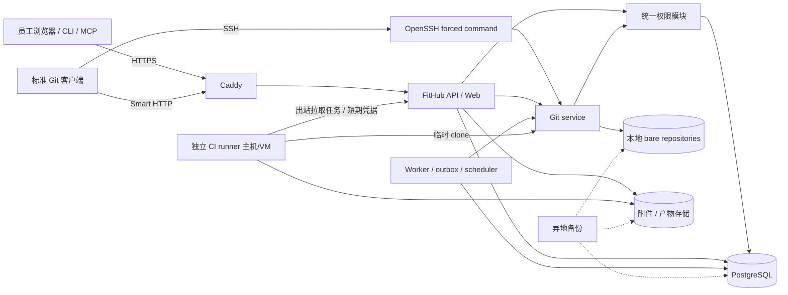

# FitHub 技术栈与系统架构

范围：10–100 名员工的自托管实例。架构决策优先考虑可实现、可恢复和运维负担；不以一开始承载 GitHub 规模为目标。

## 1. 技术选型结论

| 层次 | 首版选择 | 选择理由与限制 |
|---|---|---|
| 后端 | Go，模块化单体，`net/http` + chi | Git 子进程/流式 I/O/并发和独立部署适合；团队仍需懂 Git 与 Linux |
| Git 引擎 | 受支持的原生 Git CLI，固定并验证版本 | 直接复用 Git 对象、pack、协议与合并算法；不自写 Git 格式 |
| Git HTTPS | Go 认证网关 + `git-http-backend` | 网关决定仓库和操作权限；后端不能绕过网关公开暴露 |
| Git SSH | OpenSSH + 受限 forced-command 到 `fithub git-serve` | 复用 SSH 协议与密钥验证；用户无交互 shell、端口转发或任意命令 |
| 数据库 | PostgreSQL，pgx + sqlc；显式 SQL migrations | 事务、关系、审计和队列统一；不引入 ORM 魔法或第二套权限引擎 |
| 异步任务 | PostgreSQL outbox + jobs 表、独立 worker 进程 | 按至少一次投递设计、幂等；首版不需要 Redis/Kafka |
| 前端 | React + TypeScript + Vite + React Router | 产品为登录后交互应用，SPA 足够；不为内部平台增加 SSR 服务 |
| UI | Tailwind CSS + Radix 基础组件 | 自有视觉与无障碍交互；不依赖 GitHub 资产 |
| 状态/接口 | TanStack Query；OpenAPI 3.1 生成 TS 客户端 | 一个 REST 权限模型服务 Web/CLI/MCP |
| Markdown/diff | 维护中的 CommonMark/GFM 解析与消毒库；diff 结构由 Git 提供 | 不用 Markdown raw HTML；不以简单正则解析 Git patch |
| 文件/对象存储 | Git：本地 POSIX 文件系统；附件/产物/备份：S3 兼容 API | Git pack 不能直接当对象存储文件系统；不使用 S3 mount 托管活跃仓库 |
| 实时更新 | SSE 用于状态/日志跟随；断线可续读 | 不做复杂 WebSocket 状态系统；服务器日志缓冲受限 |
| CLI | Go + Cobra，命令名 `fh`（实现前检查命名冲突） | 跨平台发布，Git命令委托本机 git；系统 keychain 存凭据 |
| MCP | 优先官方 Go SDK（第一周验证维护状态/能力），stdio 首发 | CLI同一认证/API；若 Go SDK 能力不满足，仅 MCP adapter 改用官方 TS SDK |
| CI | 自研有限工作流控制面 + 独立 runner；首版只承诺明确子集 | runner方案由时间盒 PoC 确认，见 [CI计划](04-actions-api-cli-mcp.md) |
| TLS/入口 | Caddy + 公司 DNS/证书管理 | HTTPS 统一入口；SSH 单独端口 |
| 开发/测试 | Docker Compose、Go test、Vitest、Playwright、真实 Git CLI 集成测试 | 标准 Git 客户端行为必须验收，不能只测 REST |
| 观测 | 结构化日志、OpenTelemetry/Prometheus 指标，Grafana 按需要接入 | 首先有告警与请求追踪，避免首版部署完整重型可观测平台 |
| 生产运行 | Ubuntu LTS、容器化 app/worker/DB；Git/SSH 为受控主机服务或同机受控进程 | 单写 Git 节点；runner 在另一台主机/VM |

具体版本不在计划中猜“最新”；在 P0 锁定仍受安全维护的稳定版，记录 lockfile、容器 digest、Git/PostgreSQL 最低支持版本与升级步骤。项目代码中禁止漂移 `latest` 镜像。

### 不重复造轮子的实施边界

**优先级：直接使用成熟组件 → 做薄适配 → 按许可摘取独立实现 → 确有必要才自研。** 自研FitHub不意味着重写基础设施；能作为稳定依赖使用的组件，优先直接依赖，以便持续获得上游维护，而不是先复制进自己的代码库。

| 能力 | 直接复用 | FitHub自己负责 |
|---|---|---|
| Git对象、历史、refs、pack、GC | 原生Git及其磁盘格式 | 创建/定位仓库、配额、维护调度、备份协调 |
| clone/fetch/push传输 | Git的http-backend、upload-pack、receive-pack | 认证网关、权限检查、hooks与业务事件 |
| diff、共同祖先、冲突与merge/squash结果 | 原生Git命令与合并算法 | 选择比较基准、显示diff、决定何时允许合并、并发条件更新 |
| SSH与HTTPS | OpenSSH、Caddy/TLS实现 | 将已验证身份映射到员工与仓库权限 |
| Google身份验证与密码学 | 维护中的OIDC/OAuth/JWT库、标准加密库 | 公司域规则、账号映射、团队申请审核、会话/凭据生命周期 |
| Markdown、YAML、语法高亮、UI基础组件 | 维护中的解析/消毒/高亮库与UI组件 | 产品页面、允许的workflow字段、业务语义 |
| 数据持久化、对象传输 | PostgreSQL、数据库驱动、S3客户端 | 业务数据模型、事务边界、权限与保留策略 |
| CLI/MCP协议 | Cobra、官方MCP SDK、系统keychain集成 | FitHub命令/tool handler、参数与权限适配 |
| CI进程与隔离执行 | 系统shell、原生Git checkout、Podman/容器运行时 | workflow触发、任务状态、短期凭据、checks与执行器接入 |

特别是PR：**冲突检测和代码合并算法用Git；审批、CI门槛、合并按钮和时间线由FitHub实现。** 不自行实现Git协议、对象数据库、文本合并算法、SSH/TLS、签名验签算法或容器引擎。

CI控制面和runner agent仍有平台自研部分，不能写成“现成组件已经覆盖全部Actions”。P0必须比较现有执行器/库的接入、升级、许可和安全成本，能以薄适配满足要求就复用；仅为FitHub特有的授权与业务契约补代码。新写通用基础组件前，在ADR说明现成方案缺少什么，避免默认从零开发。

### 暂不选的方案

- 不选 Gitea fork：与自研产品目标不一致，但将其作为协议边界与行为对照。
- 不选 Rust 全栈：不是能力不足，而是这一规模收益不足以抵消开发与维护门槛；现有团队若以 Rust 为主可另行调整。
- 不用 Node 实现 Git 协议/存储：前端仍用 TS，后端 Git 调度集中在 Go，减少两套服务职责。
- 不用 `go-git` 替代服务器核心 Git：即便可以用于部分读操作，首版也统一原生 Git 行为，降低浅克隆/合并/协议差异。
- 不选 Kubernetes、微服务、Elasticsearch、复杂 RBAC DSL、分布式仓库复制：规模暂不要求；接口留边界即可。
- 不部署自建对象存储集群作为默认项：先使用已有兼容服务；若无服务，单机对象存储也必须配独立备份，且先检查所选实现的许可与维护状况。

## 2. 部署图



图中 Git service 是 **模块边界和受控进程接口**，不是第一天就部署为一个网络微服务。API、SSH wrapper、hooks 和 worker 都调用同一授权/仓库策略实现。生产中只允许它访问 bare repo；runner 不挂载 Git 存储盘。

主站初始可一台服务器部署 API、worker、PostgreSQL 和 Git；CI 至少是另一台 VM。预算受限时可以共享宿主机但必须接受宿主故障同时影响所有组件的可用性限制；执行不可信工作流时，不把仅容器隔离视为完整主机安全边界。

## 3. 模块边界与代码组织

实际代码已放在当前计划目录的 [`implementation/`](implementation/README.md) 子目录。以下是目标代码组织；当前开发版只建立了已实现模块，其他目录随着对应任务推进再添加。

```text
cmd/fithub/                 API、worker、git-serve、管理子命令
cmd/fh/                     CLI（可拆独立发布，但共享 OpenAPI）
internal/identity/          Google、session、用户状态、SSH Key
internal/authz/             权限判定与资源策略，唯一权威实现
internal/teams/             团队、加入申请、审核与成员关系
internal/repos/             仓库生命周期、ACL、可见性
internal/gitservice/        Git 子进程、bare repo、refs、hooks
internal/issues/            Issue、标签、里程碑、引用
internal/pulls/             PR、可选review、merge（不设审批门槛）
internal/actions/           workflow、调度、checks、runner lease
internal/integrations/      REST、webhook、CLI/MCP adapter
internal/audit/             安全与管理审计
internal/jobs/              outbox、重试、对账、清理
web/                        React UI
api/openapi.yaml            对外契约
db/migrations/              版本化迁移
deploy/                     Compose、生产配置样例、备份恢复脚本
tests/fixtures/             Git仓库、恶意文件名、冲突、工作流样本
third_party/                许可与必要的摘取记录
```

授权函数接收 `principal / credential / repository / action / ref`，返回 allow/deny 与稳定 reason code。禁止在 Web、Git hooks、CLI、MCP 中各自维护一份权限判断。

## 4. 核心数据模型

以下是逻辑设计，不是已经执行的 DDL。所有外部资源以不可变 ID 作为主键；slug 只用于展示与路由。

| 聚合 | 主要实体与约束 |
|---|---|
| 身份 | users、external_identities(provider,sub 唯一)、sessions、ssh_keys(fingerprint 唯一)、access_tokens |
| 团队 | teams(slug 唯一)、team_members(team,user 唯一)、team_join_requests(team,user,status,reviewer,reviewed_at,review_note)；同一用户/团队最多一条pending申请 |
| 仓库 | repositories(team,slug 唯一)、repo_grants(repo,principal 唯一)、repo_aliases、branch_rules |
| 协作编号 | repo_counters；事务分配 Issue/PR 共同序号，唯一键(repo_id,number) |
| Issue/PR共同层 | work_items(kind=issue/pull)、comments、labels、milestones、assignees、timeline_events |
| PR专属 | pulls(base/head repo/ref、head SHA、last observed base SHA)、reviews、review_threads、review_comments、merge_attempts |
| 引用 | work_item_links(source,target,relation 唯一)、closing_intents；权限过滤展示 |
| CI | workflows、workflow_runs、jobs、job_attempts、runner_leases、check_runs、log_chunks、artifacts、cache_entries |
| 集成 | webhooks、webhook_deliveries、secrets(密文)、notifications、subscriptions |
| 运行安全 | audit_events、outbox_events、background_jobs、backup_manifests |

约束与索引：

- 每张仓库业务表包含 `repo_id`；查询必须先约束可见仓库，搜索结果再分页，不能先分页再过滤权限。
- 对 Issue/PR 列表建立 `(repo_id,status,updated_at,id)` 等与查询匹配的索引；使用稳定游标，不允许无限全表扫描。
- Git commit/tree/blob 对象保留在 Git 中；PostgreSQL 只存 PR目标SHA、必要索引和有限缓存，不复制一份 Git 历史数据库。
- 时间线、通知和 webhook 使用同一个业务 event ID 作幂等键；任务至少一次投递，不承诺跨 DB/Git 的天然 exactly-once。
- 被删除的评论、PR 和用户使用 tombstone；历史作者不因用户离职而消失。
- 首次合法Google登录自动创建账号；团队成员资格不嵌入账号注册条件。批准加入申请时以事务/条件更新同时写审核结果和成员关系，重新检查账号未停用、团队仍有效；拒绝、撤回或重复审核不产生额外成员。无团队员工可读取有限团队目录与自己的申请，但无权读取团队成员列表和 internal/private 仓库。
- Git author/committer 邮箱是提交声明，不等于平台认证身份。匹配用户只是显示关联；签名验证能力未实现前，不显示“身份已验证”。

## 5. 一致性：Git 与数据库不能放进同一事务

1. 仓库创建：先创建 DB `initializing` 记录 → 临时目录初始化 bare repo 和 hooks → 原子 rename 到不可变 ID 路径 → DB 标记 active。失败可重试/清理，路径不会被半成品占据。
2. push：Git 原子更新 refs；post-receive 发事件失败不能撤销已成功 push。事件持久化与定期 refs 对账一起保证 PR/CI 最终更新。
3. PR merge：记录 merge attempt → 在隔离工作目录构建目标 commit → 使用预期 old SHA 更新 ref → 写 DB 成功事件。进程崩溃后读取实际 ref/commit 恢复状态，不能再次盲目合并。
4. 仓库 rename：先注册新 slug 与旧 alias，磁盘路径保持不变；team 转移改变授权，要重新计算 ACL、停止运行任务并审计。
5. Secret、ACL 与仓库可见性变更：服务端使用当前权威数据；不依赖过期缓存；缓存键必须包括权限版本。

## 6. 存储与资源治理

- 仓库磁盘路径用 `repos/<id-prefix>/<repo-id>.git`，不直接拼用户提供的 team/repo 名称。
- Git 子进程设置最大运行时间、进程数、CPU/内存、stdout/stderr 上限；网络 clone 不进入主站 Web 进程无限等待。
- 文件内容读取、diff、archive、历史页分别限制大小和数量。UI 明确标注“因大小截断”，不能把截断当成完整 diff。
- 仓库 GC/repack、备份和写操作必须协调；首版统一由 maintenance worker 调度，禁用无人管理的竞争维护任务。
- 产物、附件、缓存和日志有 TTL、配额和独立存储前缀；禁止缓存穿越仓库/可见性边界。
- 初始建议阈值：文件在线预览 1 MiB、单页 diff 1 MiB 或 5,000 行、首期仓库目标 5 GiB以内、单 job 日志 50 MiB/产物 1 GiB。这些是压测初值，不是 Git 协议保证；管理员可调整硬限制与告警。

## 7. 运维与恢复目标

初始目标 **RPO ≤ 24 小时、RTO ≤ 4 小时**，必须用实际恢复演练验证。不是默认承诺 99.99% 可用性。上线后若业务要求更短 RPO，再增加 PostgreSQL WAL 归档与更频繁协调备份。

备份最小集合：数据库、全部 Git refs/objects、LFS(如启用)、附件/产物中需保留部分、配置、Secret加密密钥、SSH host keys、版本清单。Secret加密密钥单独受控备份，不能只备密文后声称可恢复。

首版一致性备份过程：进入只读维护窗口 → 停止/排空 Git写入与merge、暂停相关worker → 生成数据库与Git/附件一致检查点 → 记录manifest与校验值 → 恢复写入 → 加密传输到独立位置。复制过程较长时采用文件系统快照缩短冻结窗口。每月在隔离环境恢复一次，实际 clone、检查历史、创建PR并合并。

告警最少覆盖：磁盘剩余/增长、数据库备份失败、Git子进程错误率、worker积压、runner离线、CI长时间等待、授权失败异常、TLS到期和审计写入失败。

## 8. 容量与成本规划

以下是预算起点，**不是压测结论或云厂商报价**：

| 资源 | 初始建议 | 扩展触发 |
|---|---|---|
| 主站 | 4–8 vCPU、16 GiB RAM、独立持久SSD；按库量准备 200–500 GiB | Git I/O/DB延迟持续超标，先分离DB或Git盘 |
| runner | 4–8 vCPU、8–16 GiB RAM，初始并发 2 | 等待队列超目标，增加runner；资源按真实构建需求调整 |
| 对象/备份 | 现有兼容对象存储 + 独立故障域 | 按Git历史、日志、产物保留期、恢复点数量测算 |

容量公式：Git原始占用 + GC/repack临时空间 + DB/附件 + CI临时空间 + 日志产物保留 + 备份历史 + 至少30%余量。Git维护峰值和大仓库clone会额外占用空间；不能只按代码工作目录大小估算。

主站与runner至少每月补丁维护；依赖自动更新只开PR，经过Git协议与恢复回归再部署。扩展优先级：加磁盘/runner → 分离数据库 → 单独Git服务节点 → 再考虑多节点应用；禁止两个普通应用实例无协调地并写同一裸仓库。
